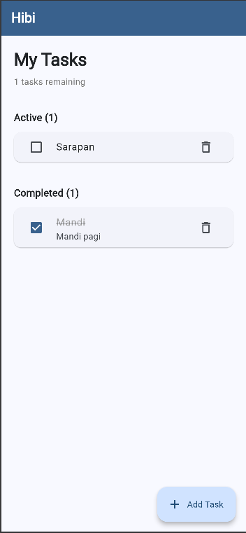

# Hibi

Aplikasi manajemen tugas (task) berbasis Flutter untuk membuat, melihat, menandai selesai, dan menghapus tugas harian dengan penyimpanan lokal menggunakan `shared_preferences`.

## Identitas Pembuat
- **Nama:** Azni Muzaiyin
- **NIM:** *103012630007*

## Tampilan & Demo Aplikasi


## Cara Menjalankan Aplikasi (How to Run)

### Prasyarat
- Flutter SDK dan Dart SDK yang sesuai dengan `pubspec.yaml`
- Git
- Android SDK & JDK 17

### 1. Clone Repositori & Instal Dependensi
```bash
git clone [https://github.com/ItsAzni/hibi.git](https://github.com/ItsAzni/hibi.git)
cd hibi
flutter pub get
```

### Deklarasi Penggunaan AI
- Apakah menggunakan AI? **Ya**
- Tool AI yang digunakan: **Gemini**
- Estimasi persentase kontribusi AI: 40%
- Bagian kode/fitur yang dibantu AI: 
  1. System penyimpanan data (LocalStorageService)
  2. Penanganan error serta state loading pada LocalStorageService dan HomeScreen
  3. Workflow github (workflow_dispatch) untuk build APK.
- Pernyataan: 
  "Saya menyatakan bahwa saya memahami alur dan fungsi dari seluruh kode yang ada dalam repositori ini"
